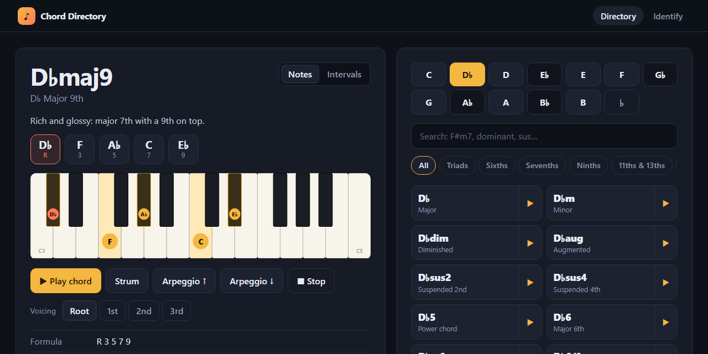

# Chord Directory


[](LICENSE)
[](https://github.com/kreaton/ChordDirectory/stargazers)

⭐ If Chord Directory helps you find your way around the keyboard, [star it on GitHub](https://github.com/kreaton/ChordDirectory). It's free, made by one developer, and stars are how other people find it.



**Browse, see and hear piano chords in every key, and find out what the chord under your fingers is called.**

▶️ **Try it:** <https://kreaton.github.io/ChordDirectory/>

It is a Blazor WebAssembly app (.NET 10) that runs entirely in the browser, with no server or backend. All sound is synthesised in the browser with Web Audio, so there are no samples to download.

## What's in it

- **Directory**: 38 chord types (triads, 6ths, 7ths, 9ths, 11ths/13ths, altered and suspended) for all 12 roots, with a ♯/♭ spelling switch. Notes are spelled correctly (D♭maj7 = D♭ F A♭ C, never E♯).
- **See it**: every chord is drawn on an SVG piano, with notes or intervals as labels, the root highlighted, and inversions.
- **Hear it**: play as a block chord, strum, or arpeggio up/down. Four synthesised instruments (piano, electric piano, organ, synth pad), volume and arpeggio speed. Click any key to hear it; keys light up while sounding.
- **Search**: `F#m7`, `Bbmaj7`, `dominant`, `sus`, `half-dim`…
- **Identify**: press keys on the piano and see every chord name that fits, including slash chords (C/E) and enharmonic equivalents (Am7 = C6/A).
- Deep links: `/chord/Db/maj7`.

To add a chord, add one line to `Music/ChordCatalog.cs`: a formula such as `"1 b3 5 b7"` is all it needs (notes, spelling, voicings, search and identification come for free).

## Caveats

- Chords are shown in one close voicing per inversion. Real players often leave notes out of big chords (the 11th or the 5th of a 13th, for example) or spread them over both hands.
- Identify only finds chords in the directory, and only when the keys you press are exactly that chord's notes.
- Sound settings are not saved between visits.

## Project layout

```
ChordDirectory.slnx
src/ChordDirectory/
  Music/             Plain C# theory: spelling, chord catalogue (formulas), voicings, identification, search
  Components/        The SVG piano keyboard and the sound settings
  Pages/             Browse (the directory and chord detail) and Identify
  Services/          AudioService: C# wrapper for the audio engine; tracks sounding notes for the keyboard
  BuildInfo.cs       Version, build time and commit shown in the footer
  wwwroot/
    index.html       Host page, <base href>
    css/app.css      All styling
    js/audio.js      Web Audio synth: instruments, envelopes, reverb, strum and arpeggio scheduling
    manifest.webmanifest
    icons/           App icons and favicon, rendered from art/icon.svg
tests/ChordDirectory.Tests/
  Program.cs         Checks the music theory code without a browser
art/icon.svg         Source of the app icon
tools/
  make-icons.ps1     Renders the PNG icons from art/icon.svg
  make-banner.ps1    Takes the README banner (images/banner.png) from the running app
```

## Running locally

Requires the [.NET 10 SDK](https://dotnet.microsoft.com/download).

```bash
dotnet run --project src/ChordDirectory
```

Then open http://localhost:5236.

Stop the app before building it again. A running dev server keeps the list of files it started with, and after a rebuild the page can hang while loading.

## Tests

```bash
dotnet run --project tests/ChordDirectory.Tests
```

The test runner checks note spelling (double flats and sharps included), that every chord in every key and inversion fits on the keyboard with one key per note, URL slugs, search parsing (`F#m7`, `dominant`, `dim` is not D + "im", `CM7` versus `Cm7`) and chord identification (slash chords, enharmonic names, ♯/♭ spelling). The exit code is the number of failed checks.

## Publishing

Pushing to `main` runs the tests, builds the app and deploys it to GitHub Pages (<https://kreaton.github.io/ChordDirectory/>) with [`.github/workflows/deploy.yml`](.github/workflows/deploy.yml). The version is `1.0.<run number>`, set in [`Directory.Build.props`](Directory.Build.props).

Pages serves the app from `/ChordDirectory/`, so the workflow rewrites `<base href="/" />` in `index.html` to match.

## Icons and banner

Both are made with Windows PowerShell and headless Edge:

```bash
powershell -File tools/make-icons.ps1
powershell -File tools/make-banner.ps1   # with the app running on localhost:5236
```

## License & Authorship

This project is distributed under the terms of the [MIT License](LICENSE).

**AI authorship note:** Most of the source code in this repository was generated with AI coding agents (Claude Code), under my direction and review. Purely AI-generated material may not be eligible for copyright protection in some jurisdictions. To the extent any part of this project is protected by copyright, it is licensed under the MIT License, and the license's warranty and liability disclaimers apply to the project as a whole.

<!-- notices:start -->
### Independent development

ChordDirectory is an independent, personal project developed by Per Hejndorf. It is not affiliated with, endorsed by or sponsored by Microsoft or any other rights holder. Product names and logos are trademarks of their respective owners and are used only to identify the services and tools the project works with.

### Third-party notices and asset provenance

[THIRD-PARTY-NOTICES.md](THIRD-PARTY-NOTICES.md) lists every third-party library, font and online service the project uses, with version, licence, source and whether it was modified. It also records where the icons, images, audio and video came from and how they are licensed.
<!-- notices:end -->
